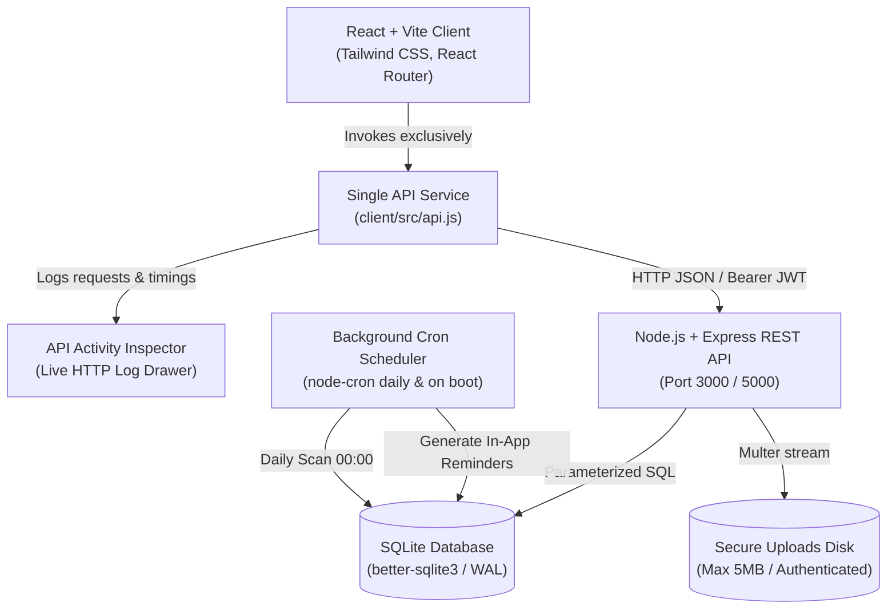

# LifeVault — Personal Document & Warranty Reminder Portal

> **"Keep important documents close, and every expiry date in sight."**

LifeVault is a full-stack, secure personal document and warranty reminder portal designed to solve the scattered paperwork problem. It stores document and warranty records, automatically computes urgency and expiry states, evaluates upcoming deadlines through scheduled background cron jobs, and keeps the live connection between frontend and backend transparent to the user at all times.

---

## 🏛️ Architecture & Connectivity

LifeVault is built as a unified monorepo providing clean separation of client, server, and shared date calculation utilities:



### Key Connectivity & Transparency Features
1. **Header Connection Pill**: Polls `/api/health` every 10 seconds. Renders `"Backend: Connected (XX ms)"` in mint (`#DFF1E7`) with live latency, or `"Backend: Disconnected"` in rose (`#F8E5E7`) with explicit textual labels.
2. **System Diagnostics Page (`/system-status`)**: Live real-time status of API base URL, Express REST server, SQLite database WAL mode, server uptime, authentication token validity, file storage metrics, email reminder status, and background cron last-run summaries.
3. **Collapsible API Activity Inspector**: A drawer fixed at the bottom of the screen displaying every outgoing HTTP request, method badges (GET, POST, PUT, DELETE, PATCH), endpoints, HTTP status codes, response durations in milliseconds, and failure indicators with error details.
4. **Resilient Failure Banners & Toasts**: If the backend is unreachable, a persistent banner informs the user: *"Cannot reach server. Your changes are not saved."* with a "Retry Connection" action. Upon save, update, or deletion, user feedback toasts show database confirmation (e.g., *"Record saved to database (ID 12)"*).
5. **Database Origin Attribution**: The footer explicitly discloses *"Data source: SQLite via LifeVault API"*.

---

## 🚀 Setup & Execution

### Prerequisites
- Node.js 18+ (tested on Node 20 / 22)
- npm 9+

### 1. Install Dependencies
```bash
npm install
```

### 2. Seed Database with Demo Records
Populate the database with a test user and 10 realistic fictional records spanning Active, Expiring soon, Expired, and Permanent documents:
```bash
npm run seed
```

**Pre-seeded Demo User Credentials:**
- **Email**: `demo@lifevault.test`
- **Password**: `Demo@1234`
*(Click the "Fill Demo" button on the Sign In page for one-click authentication)*

### 3. Run Development Server
```bash
npm run dev
```
- In AI Studio / Cloud Run: Launches the full-stack server on `http://0.0.0.0:3000` with Express handling `/api/*` and mounting Vite middleware for the SPA client.
- Standalone multi-process dev: `npm run dev:all` (runs `npm run dev:server` on port 5000 and `npm run dev:client` on port 3000 with `concurrently`).

### 4. Run Automated Backend Tests
Runs Jest + Supertest test suites covering 27 unit and integration tests:
```bash
npm test
```

---

## 🔌 REST API Specification

All records endpoints require an `Authorization: Bearer <JWT>` header. Ownership verification is strictly enforced: users can only read, update, or delete their own records.

| Method | Endpoint | Description | Auth Required |
| :--- | :--- | :--- | :--- |
| `GET` | `/api/health` | System health check, database status, uptime, cron status, email config | No |
| `POST` | `/api/auth/register` | Register new user with hashed password (`name`, `email`, `password`) | No |
| `POST` | `/api/auth/login` | Authenticate user, rate-limited (5 attempts/15m), returns JWT | No |
| `GET` | `/api/auth/me` | Fetch authenticated user profile details | Yes |
| `GET` | `/api/records` | Query records with `?search=&category=&status=` | Yes |
| `POST` | `/api/records` | Create new document or warranty record (validates dates & chronology) | Yes |
| `GET` | `/api/records/:id` | Fetch single record (verifies user ownership, returns 403 if unauthorized) | Yes |
| `PUT` | `/api/records/:id` | Update record fields and modification timestamp | Yes |
| `DELETE` | `/api/records/:id` | Permanently remove record and linked physical attachment | Yes |
| `POST` | `/api/records/:id/file` | Upload attachment (PDF/JPG/PNG/WEBP, max 5 MB, type-checked) | Yes |
| `GET` | `/api/records/:id/file` | Authenticated file download (files are **never** publicly served) | Yes |
| `GET` | `/api/upcoming?days=30` | Sorted timeline of nearest upcoming expirations & aggregate counts | Yes |
| `GET` | `/api/notifications` | In-app reminders generated by automated cron job | Yes |
| `PATCH` | `/api/notifications/:id/read` | Mark in-app reminder as read | Yes |
| `POST` | `/api/notifications/read-all` | Mark all user notifications as read | Yes |
| `POST` | `/api/notifications/run-cron` | Manually trigger reminder scan and evaluation | Yes |

---

## 📋 Features: Implemented vs. Not Implemented

### ✅ Implemented
- [x] **Monorepo Structure**: Complete separation of `/client`, `/server`, and root orchestration.
- [x] **Single API Service**: All client requests exclusively use `client/src/api.js` using standard `fetch` with `VITE_API_URL` configuration.
- [x] **SQLite Database & WAL**: `better-sqlite3` implementation with foreign keys enabled, parameterized queries, and WAL mode.
- [x] **JWT Authentication & Passwords**: Secure registration and login using `jsonwebtoken` and `bcryptjs` salt hashing.
- [x] **Login Rate Limiter**: Memory-based rate limiter enforcing 5 attempts per 15-minute window with informative 429 errors.
- [x] **Strict Data Ownership**: Users can never access, edit, delete, or download records or attachments belonging to another user (HTTP 403 Forbidden).
- [x] **Chronological Date Validation**: Rejection of expiry dates preceding issue dates and warranty end dates preceding purchase dates.
- [x] **Automated Warranty Calculation**: Real-time projection of warranty end dates based on purchase date + coverage months.
- [x] **Authenticated File Management**: Multer upload pipeline restricting files to 5 MB, type-checking MIME types, and streaming downloads exclusively to authorized owners.
- [x] **Background Cron Reminders**: `node-cron` scheduler evaluating records on startup and daily at midnight, generating deduplicated in-app notifications.
- [x] **Honest Email Configuration**: Optional `nodemailer` integration. If SMTP credentials are not configured, the system logs *"Email reminders not configured"* and explicitly displays this on the System Status page without false delivery claims.
- [x] **Full-Stack Connectivity Transparency**:
  - Live Header Connection Pill with millisecond latency polling.
  - Collapsible API Activity Inspector logging every request, method, status, duration, and error.
  - Dedicated System Diagnostics page (`/system-status`).
  - Network failure banner warning *"Cannot reach server. Your changes are not saved."*
  - Success toasts confirming database operations with assigned primary key IDs.
- [x] **Automated Tests**: 27 passing Jest + Supertest tests covering auth, CRUD, ownership, file restrictions, health, and expiry edge cases.
- [x] **Manual Test Matrix**: Fully structured `TESTING.md` with TC01 through TC17.

### ⚠️ Not Implemented / Out of Scope
- **Third-Party Cloud Storage**: File attachments are stored locally on the server filesystem (`server/uploads/`) rather than AWS S3 or Google Cloud Storage.
- **Push Notifications (Web Push / SMS)**: Notifications are provided as in-app inbox alerts and optional SMTP email reminders; browser Web Push API and SMS gateways are not implemented.

---

## 🔒 Security & Privacy Notice

- **Prototype Disclaimer**: LifeVault is intended for testing and demonstration with fictional data only. Do not upload genuine government-issued passports, real driver's licenses, or confidential financial receipts.
- **SQL Injection Prevention**: All database interactions use prepared statements with parameter binding via `better-sqlite3`.
- **Private Attachment Storage**: Uploaded files reside outside the web server's static directory and can only be retrieved via authenticated streams matching the owner's user ID.
